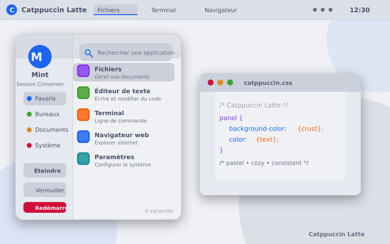
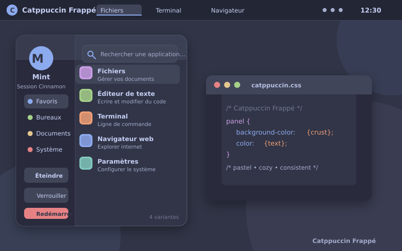
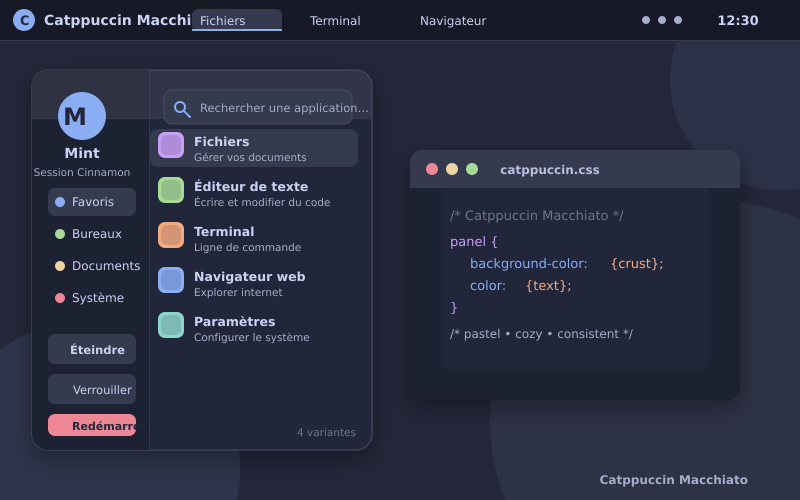
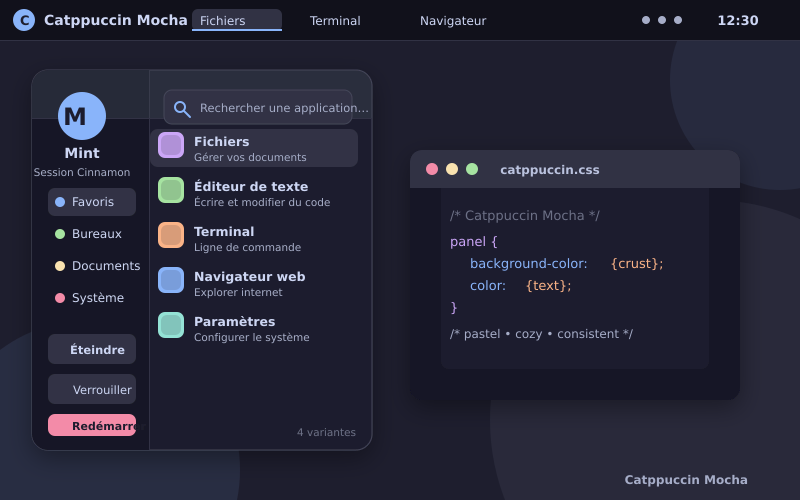

# Catppuccin pour Cinnamon

Thème complet pour l'interface Cinnamon de Linux Mint, décliné dans les quatre
flavors officiels de [Catppuccin](https://catppuccin.com/palette/) : **Latte**,
**Frappé**, **Macchiato** et **Mocha**.

Le thème couvre le panneau (quatre orientations), le menu d'applications
(classique et nouveau menu Cinnamon 6.6+), les applets, la liste des fenêtres,
Alt-Tab, les notifications, l'OSD, le calendrier, les dialogues, l'écran de
verrouillage, Expo, les desklets, IBus et le clavier virtuel.

## Aperçus

| Latte | Frappé |
| --- | --- |
|  |  |
| **Macchiato** | **Mocha** |
|  |  |

Une galerie HTML autonome des quatre variantes est également générée dans
[previews/overview.html](previews/overview.html).

## Variantes

| Variante | Type | Fond | Panneau | Texte | Accent |
| --- | --- | --- | --- | --- | --- |
| Catppuccin Latte | clair | `#eff1f5` | `#dce0e8` | `#4c4f69` | `#1e66f5` |
| Catppuccin Frappé | sombre | `#303446` | `#232634` | `#c6d0f5` | `#8caaee` |
| Catppuccin Macchiato | sombre | `#24273a` | `#181926` | `#cad3f5` | `#8aadf4` |
| Catppuccin Mocha | sombre | `#1e1e2e` | `#11111b` | `#cdd6f4` | `#89b4fa` |

Chaque flavor est un thème Cinnamon distinct : les quatre apparaissent donc
séparément dans **Paramètres → Thèmes**.

## Installation

### Script d'installation

Sur la machine Linux Mint :

```bash
git clone <url-du-depot> Cinnamon_Catppuccin
cd Cinnamon_Catppuccin
./scripts/install.sh
```

Les thèmes sont copiés dans `~/.themes/`. Pour choisir un autre répertoire :

```bash
./scripts/install.sh --dest ~/.local/share/themes
```

### Copie manuelle

```bash
mkdir -p ~/.themes
cp -r dist/Catppuccin-Latte dist/Catppuccin-Frappe \
      dist/Catppuccin-Macchiato dist/Catppuccin-Mocha ~/.themes/
```

Les archives `dist/Catppuccin-<Flavor>.zip` contiennent le dossier complet du
thème. L'archive `dist/Catppuccin-Cinnamon-all-flavors.zip` regroupe les quatre
variantes.

### Activation

1. Ouvrir **Menu → Préférences → Thèmes** (ou **Paramètres système → Thèmes**).
2. Choisir **Catppuccin Latte**, **Frappé**, **Macchiato** ou **Mocha**.
3. Si le changement n'est pas immédiat, appuyer sur **Ctrl+Alt+Échap** pour
   redémarrer Cinnamon.

Selon la version de Cinnamon, le sélecteur peut afficher le nom du dossier
(`Catppuccin-Latte`) plutôt que « Catppuccin Latte ».

## Compilation et personnalisation

Le projet ne demande que Python 3 (bibliothèque standard), sans Pillow ni
compilateur Sass.

```bash
python3 scripts/build.py
```

ou, avec `make` :

```bash
make build
```

Les fichiers générés sont écrits dans `dist/` et les aperçus SVG dans
`previews/`. Pour changer la couleur d'accentuation (bleu par défaut) :

```bash
python3 scripts/build.py --accent mauve
# ou
make ACCENT=mauve
```

Accents disponibles : `rosewater`, `flamingo`, `pink`, `mauve`, `red`,
`maroon`, `peach`, `yellow`, `green`, `teal`, `sky`, `sapphire`, `blue`,
`lavender`.

> Les fichiers de `dist/` sont générés. Pour modifier durablement le thème,
> éditez `src/cinnamon.css.in`, `src/index.theme.in`, `palette.json` ou
> `scripts/build.py`, puis relancez la compilation.

## Vérifications locales et CI

```bash
bash scripts/check.sh
```

La CI GitHub exécute cette commande sur les push vers `main` et les pull
requests, avec Python 3.12. Elle vérifie la syntaxe Bash et Python, reconstruit
les quatre thèmes dans un répertoire temporaire, puis contrôle les assets CSS
et le contenu et l'intégrité des cinq archives. Les livrables locaux restent
inchangés. Ces contrôles ne valident pas le rendu dans Cinnamon/X11.

Le workflow de Release est encore hérité de CinnaFlow et doit être adapté avant
toute création de tag ou de Release.

## Structure du dépôt

```text
palette.json              palette officielle des quatre flavors
src/cinnamon.css.in       feuille de style Cinnamon (gabarit)
src/index.theme.in        métadonnées du thème
src/overview.html.in      gabarit de la galerie HTML
scripts/build.py          génération des thèmes, assets, PNG et archives
scripts/check.sh          contrôles statiques et compilation temporaire pour la CI
scripts/install.sh        installation dans ~/.themes
dist/                     thèmes prêts à installer et archives zip
previews/                 aperçus SVG et galerie HTML des quatre variantes
```

Chaque thème généré contient :

```text
Catppuccin-Mocha/
├── LICENSE
├── index.theme
└── cinnamon/
    ├── cinnamon.css
    ├── thumbnail.png
    ├── checkbox-off.svg
    ├── checkbox.svg
    ├── radio-off.svg
    ├── radio.svg
    ├── toggle-off.svg
    ├── toggle-on.svg
    ├── calendar-arrow-*.svg
    ├── add-workspace*.svg
    ├── close.svg
    ├── trash-icon.svg
    └── corner-ripple.png
```

## Choix de couleurs

Le thème suit le guide de style Catppuccin :

- **Panneau** : `Crust`, avec une bordure `Surface 0`.
- **Menus et fenêtres** : `Base`.
- **Barre latérale, sous-menus, notifications** : `Mantle`.
- **Survol et sélection** : `Surface 0`, `Surface 1` et `Surface 2`.
- **Texte principal** : `Text` ; texte secondaire : `Subtext 0/1` ;
  désactivé : `Overlay 1`.
- **Accent** : `Blue` par défaut, avec `Base` comme texte sur accent.
- **Liens** : `Blue` ; survol : `Sky`.
- **Succès / avertissement / erreur** : `Green` / `Yellow` / `Red`.
- **Sélection de texte** : `Blue` avec texte `Base` ; sélection générique :
  `Overlay 2` à 30 %.
- **Coins arrondis** : 8 px pour les éléments, 12 à 18 px pour les surfaces.

Le rendu est volontairement plat, sans dégradés, pour rester proche de
l'esthétique Catppuccin.

## Compatibilité et limites

- Conçu pour Cinnamon 5.x et 6.x sur Linux Mint. Les sélecteurs du nouveau menu
  d'applications (Cinnamon 6.6+) et de l'ancien menu sont tous les deux inclus.
- Le thème couvre l'interface Cinnamon (shell), pas les applications GTK, les
  icônes, les curseurs ou le gestionnaire de fenêtres.
- Pour un bureau entièrement Catppuccin, compléter avec le port
  [Catppuccin GTK](https://github.com/catppuccin/gtk), un thème d'icônes adapté
  et éventuellement un thème de curseurs.
- La compilation valide le CSS, les SVG et les PNG, mais le rendu final doit
  être vérifié dans une session Cinnamon réelle (le développement de ce dépôt
  peut se faire sur macOS). En cas de problème, consulter
  `~/.cinnamon/glass.log` et `~/.xsession-errors`.

## Désinstallation

```bash
rm -rf ~/.themes/Catppuccin-*
```

## Crédits

- Palette et guide de style : [Catppuccin](https://catppuccin.com/palette/),
  sous licence MIT.
- Structure des sélecteurs : thème par défaut de
  [Cinnamon](https://github.com/linuxmint/cinnamon).
- Code du thème : voir [LICENSE](LICENSE) (MIT).
