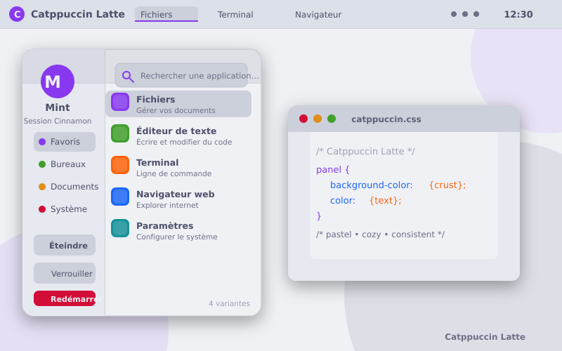
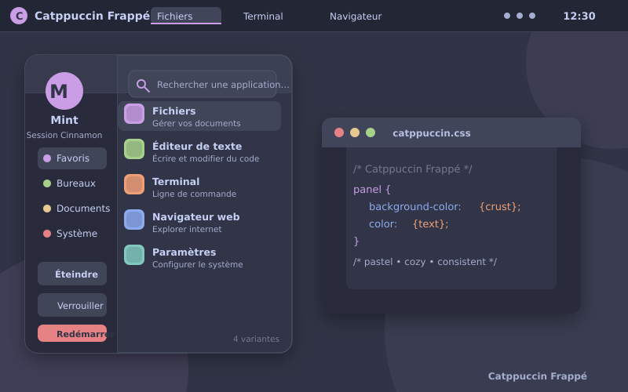
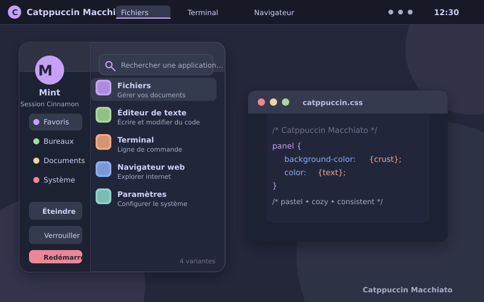
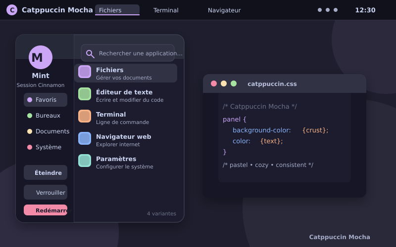

# Catppuccin pour Cinnamon

Thème complet pour l'interface Cinnamon de Linux Mint, décliné dans les quatre
flavors officiels de [Catppuccin](https://catppuccin.com/palette/) : **Latte**,
**Frappé**, **Macchiato** et **Mocha**.

Le thème couvre le panneau (quatre orientations), le menu d'applications
(classique et nouveau menu Cinnamon 6.6+), les applets, la liste des fenêtres,
Alt-Tab, les notifications, l'OSD, le calendrier, les dialogues, l'écran de
verrouillage, Expo, les desklets, IBus et le clavier virtuel. Il fournit aussi
un thème GTK 2, GTK 3 et GTK 4 pour les applications, généré depuis la même
palette et basé sur Adwaita. Des thèmes complémentaires recolorés fournissent
aussi les icônes (Kora) et les curseurs (Vimix) en Mocha avec l’accent bleu.

## Aperçus

| Latte | Frappé |
| --- | --- |
|  |  |
| **Macchiato** | **Mocha** |
|  |  |

Une galerie HTML autonome des quatre variantes est également générée dans
[previews/overview.html](previews/overview.html).

## Variantes

| Variante | Type | Fond | Panneau | Texte | Accent |
| --- | --- | --- | --- | --- | --- |
| Catppuccin Latte | clair | `#eff1f5` | `#dce0e8` | `#4c4f69` | `#1e66f5` |
| Catppuccin Frappé | sombre | `#303446` | `#232634` | `#c6d0f5` | `#8caaee` |
| Catppuccin Macchiato | sombre | `#24273a` | `#181926` | `#cad3f5` | `#8aadf4` |
| Catppuccin Mocha | sombre | `#1e1e2e` | `#11111b` | `#cdd6f4` | `#89b4fa` |

Chaque flavor est un thème distinct : les quatre apparaissent séparément dans
**Paramètres → Thèmes**, à la fois dans **Bureau** (interface Cinnamon) et dans
**Applications** (thème GTK).

## Installation

### Script d'installation

Sur la machine Linux Mint :

```bash
git clone https://github.com/Masternaka/Cinnamon_Catppuccin.git Cinnamon_Catppuccin
cd Cinnamon_Catppuccin
./scripts/install.sh
```

Les thèmes Cinnamon/GTK sont copiés dans `~/.themes/` et les thèmes
complémentaires Kora (icônes) et Vimix (curseurs) dans `~/.icons/`. Pour
choisir d'autres répertoires :

```bash
./scripts/install.sh --dest ~/.local/share/themes \
  --companions-dest ~/.local/share/icons
```

Un dossier `Catppuccin-*` déjà présent à la destination est remplacé. Pour
vérifier les actions sans rien écrire, conserver l'ancienne version, ou ne pas
installer Kora/Vimix :

```bash
./scripts/install.sh --dry-run
./scripts/install.sh --backup   # renomme l'ancien thème en <nom>.bak-<date>
./scripts/install.sh --no-companions
```

### Copie manuelle

```bash
mkdir -p ~/.themes ~/.icons
cp -r dist/Catppuccin-Latte dist/Catppuccin-Frappe \
      dist/Catppuccin-Macchiato dist/Catppuccin-Mocha ~/.themes/
unzip dist/Catppuccin-Kora-Mocha-Icons.zip -d ~/.icons/
unzip dist/Catppuccin-Vimix-Mocha-Cursors.zip -d ~/.icons/
```

Les archives `dist/Catppuccin-<Flavor>.zip` contiennent le dossier complet du
thème. L'archive `dist/Catppuccin-Cinnamon-all-flavors.zip` regroupe les quatre
variantes. `dist/Catppuccin-Kora-Mocha-Icons.zip` et
`dist/Catppuccin-Vimix-Mocha-Cursors.zip` contiennent les thèmes
complémentaires recolorés (Mocha, accent bleu).

### Activation

1. Ouvrir **Menu → Préférences → Thèmes** (ou **Paramètres système → Thèmes**).
2. Dans la section **Bureau**, choisir **Catppuccin Latte**, **Frappé**,
   **Macchiato** ou **Mocha**.
3. Dans la section **Applications**, choisir le même flavor : c'est le thème
   GTK 3/4 utilisé par les applications.
4. Facultatif : dans **Icônes**, choisir **Catppuccin Kora Mocha**, puis dans
   **Pointeur de la souris**, choisir **Catppuccin Vimix Mocha**.
5. Si le changement n'est pas immédiat, appuyer sur **Ctrl+Alt+Échap** pour
   redémarrer Cinnamon.

Selon la version de Cinnamon, le sélecteur peut afficher le nom du dossier
(`Catppuccin-Latte`) plutôt que « Catppuccin Latte ».

Le thème GTK importe Adwaita pour la géométrie des widgets, puis applique les
couleurs Catppuccin. Les applications qui utilisent libadwaita (une partie des
applications GNOME) ignorent en grande partie les thèmes GTK tiers : elles
gardent leur apparence Adwaita même lorsque Catppuccin est sélectionné.

## Compilation et personnalisation

Le projet ne demande que Python 3 (bibliothèque standard), sans Pillow ni
compilateur Sass.

```bash
python3 scripts/build.py
```

ou, avec `make` :

```bash
make build
```

Les fichiers générés sont écrits dans `dist/` et les aperçus SVG dans
`previews/`. Pour changer la couleur d'accentuation (bleu par défaut) :

```bash
python3 scripts/build.py --accent mauve
# ou
make ACCENT=mauve
```

Accents disponibles : `rosewater`, `flamingo`, `pink`, `mauve`, `red`,
`maroon`, `peach`, `yellow`, `green`, `teal`, `sky`, `sapphire`, `blue`,
`lavender`. L'accent ne s'applique qu'aux thèmes Cinnamon/GTK ; les icônes et
curseurs complémentaires sont recolorés une fois pour **Mocha** avec l'accent
bleu.

Pour régénérer les icônes Kora et les curseurs Vimix après une modification :

```bash
python3 scripts/recolor_companions.py
# ou
make companions
```

> Les fichiers de `dist/` sont générés. Pour modifier durablement le thème,
> éditez `src/cinnamon.css.in`, `src/gtk3.css.in`, `src/gtk4.css.in`,
> `src/gtk2.gtkrc.in`, `src/index.theme.in`, `palette.json` ou
> `scripts/build.py`, puis relancez la compilation. Pour les icônes et
> curseurs, modifiez leurs SVG/Xcursor sources puis relancez
> `scripts/recolor_companions.py`.

## Vérifications locales et CI

```bash
make check
# ou
bash scripts/check.sh
```

La CI GitHub exécute cette commande sur les push vers `main` et les pull
requests, avec Python 3.12. Elle lance les tests unitaires de `build.py`,
vérifie la syntaxe Bash et Python, reconstruit
les quatre thèmes dans un répertoire temporaire, puis contrôle les assets CSS
Cinnamon et GTK ainsi que le contenu et l'intégrité des sept archives. Elle
vérifie aussi que les icônes Kora et les curseurs Vimix sont bien recolorés
(script idempotent), que leurs licences GPL-3.0 et notices sont présentes, et
teste l'installateur (`--dry-run`, installation des thèmes et des
complémentaires, `--backup`) dans un répertoire temporaire. Elle vérifie enfin
que les artefacts suivis (`dist/` et `previews/`) correspondent à une
compilation fraîche : modifier un gabarit sans relancer
`python3 scripts/build.py` fait donc échouer le contrôle. Les livrables locaux
restent inchangés. Ces contrôles ne valident pas le rendu dans Cinnamon/X11.

Les sept archives zip sont reproductibles : leurs entrées portent une date fixe, si
bien que deux compilations produisent des fichiers identiques octet pour octet
(la variable `SOURCE_DATE_EPOCH` est respectée si elle est définie).

Un second passage compile le thème avec un autre accent (`--accent mauve`) pour
détecter un jeton spécifique à l'accent par défaut.

### Publication

Le workflow `Release` prépare une release **en brouillon** contenant les sept
archives (`Catppuccin-Latte.zip`, `Catppuccin-Frappe.zip`,
`Catppuccin-Macchiato.zip`, `Catppuccin-Mocha.zip`,
`Catppuccin-Cinnamon-all-flavors.zip`, `Catppuccin-Kora-Mocha-Icons.zip` et
`Catppuccin-Vimix-Mocha-Cursors.zip`). Il se déclenche sur un tag `v*` ou
manuellement, exige que le tag pointe sur le commit courant, ne déplace jamais
un tag existant et ne publie pas la release à votre place : la vérification
finale reste manuelle dans GitHub.

## Structure du dépôt

```text
palette.json              palette officielle des quatre flavors
src/cinnamon.css.in       feuille de style Cinnamon (gabarit)
src/gtk3.css.in           feuille de style GTK 3 (gabarit)
src/gtk4.css.in           feuille de style GTK 4 (gabarit)
src/gtk2.gtkrc.in         couleurs GTK 2 (gabarit)
src/index.theme.in        métadonnées du thème
src/overview.html.in      gabarit de la galerie HTML
scripts/build.py          génération des thèmes, assets, PNG et archives
scripts/recolor_companions.py  recoloration de Kora et Vimix (Mocha, accent bleu)
scripts/test_build.py     tests unitaires des helpers de build (contrastes, jetons)
scripts/check.sh          contrôles statiques, compilation temporaire et comparaison de dist/ et previews/
scripts/verify-cinnamon.sh vérification d'une installation dans une session Cinnamon (lecture seule)
scripts/install.sh        installation des thèmes et des complémentaires
icons/Catppuccin-Kora-Mocha/    thème d'icônes recoloré (source et livrable)
cursors/Catppuccin-Vimix-Mocha/ thème de curseurs recoloré (source et livrable)
dist/                     thèmes prêts à installer et sept archives zip
previews/                 aperçus SVG et galerie HTML des quatre variantes
```

Chaque thème généré contient :

```text
Catppuccin-Mocha/
├── LICENSE
├── index.theme
├── cinnamon/
│   ├── cinnamon.css
│   ├── thumbnail.png          # bandeau 247 × 60 affiché par le sélecteur
│   ├── checkbox-off.svg
│   ├── checkbox.svg
│   ├── radio-off.svg
│   ├── radio.svg
│   ├── toggle-off.svg
│   ├── toggle-on.svg
│   ├── calendar-arrow-*.svg
│   ├── add-workspace*.svg
│   ├── close.svg
│   ├── trash-icon.svg
│   └── corner-ripple.png
├── gtk-2.0/
│   └── gtkrc
├── gtk-3.0/
│   ├── gtk.css
│   ├── gtk-dark.css
│   ├── thumbnail.png          # aperçu 120 × 36 de la section Applications
│   └── assets/
│       ├── check.svg
│       ├── check-mixed.svg
│       ├── radio.svg
│       ├── check-disabled.svg
│       ├── check-mixed-disabled.svg
│       └── radio-disabled.svg
└── gtk-4.0/
    ├── gtk.css
    ├── gtk-dark.css
    ├── thumbnail.png
    └── assets/ (mêmes fichiers que gtk-3.0/assets)
```

Les thèmes complémentaires ont leur propre dossier, installé dans `~/.icons` :

```text
icons/Catppuccin-Kora-Mocha/
├── LICENSE                       # GPL-3.0 (Kora)
├── NOTICE.md
├── index.theme
├── actions/ … status/            # SVG recoloriés (apps/ préservé)
└── create-new-icon-theme.cache.sh

cursors/Catppuccin-Vimix-Mocha/
├── LICENSE                       # GPL-3.0 (Vimix-cursors)
├── NOTICE.md
├── index.theme
└── cursors/                      # fichiers Xcursor et liens symboliques
```

## Choix de couleurs

Le thème suit le guide de style Catppuccin :

- **Panneau** : `Crust`, avec une bordure `Surface 0`.
- **Menus et fenêtres** : `Base`.
- **Barre latérale, sous-menus, notifications** : `Mantle`.
- **Survol et sélection** : `Surface 0`, `Surface 1` et `Surface 2`.
- **Texte principal** : `Text` ; texte secondaire : `Subtext 0/1` ;
  désactivé : `Overlay 1`.
- **Accent** : `Blue` par défaut, avec `Base` comme texte sur accent.
- **Liens** : `Blue` ; survol : `Sky`.
- **Succès / avertissement / erreur** : `Green` / `Yellow` / `Red`.
- **Sélection de texte** : `Blue` avec texte `Base` ; sélection générique :
  `Overlay 2` à 30 %.
- **Coins arrondis** : 8 px pour les éléments, 12 à 18 px pour les surfaces.

Le rendu est volontairement plat, sans dégradés, pour rester proche de
l'esthétique Catppuccin. La partie GTK réutilise exactement ces jetons :
`@base@` pour les fenêtres, `@mantle@` pour les barres latérales et les menus,
`@surface0@` à `@surface2@` pour les contrôles, `@accent@` pour les sélections,
les boutons suggérés et les interrupteurs.

Les thèmes complémentaires suivent la même palette, en **Mocha avec l'accent
bleu** : les icônes d'interface Kora (dossiers, actions, panneau, statut,
catégories) et les curseurs Vimix sont recolorés, tandis que les icônes
d'applications (`apps/`) conservent leurs couleurs de marque. Les curseurs
utilisent `Base` pour le corps, `Text` pour le contour et les accents
Catppuccin pour les badges (copie, aide, interdiction, attente).

## Accessibilité et contrastes

Les accents Catppuccin sont pastel : utilisés tels quels comme couleur de texte
sur les flavors clairs, ils descendent sous le ratio WCAG de 4,5:1. Le build
dérive donc des jetons de premier plan dédiés, en ne modifiant que la
luminosité (teinte et saturation officielles conservées) :

- `@text_secondary@` pour le texte secondaire ;
- `@text_success@`, `@text_warning@`, `@text_error@`, `@text_info@` pour le
  texte sémantique ;
- `@link@` et `@link_hover@` pour les liens.

Les remplissages, bordures et indicateurs continuent d'utiliser les couleurs
exactes de la palette (`@green@`, `@yellow@`, `@red@`, `@blue@`…). Sur Latte,
`Yellow` devient ainsi un ambre foncé (`#8a5812`) au lieu d'un jaune illisible
sur fond clair ; les flavors sombres gardent leurs couleurs d'origine, déjà au
dessus du seuil.

La couleur du texte posé sur l'accent suit la même règle : `@on_accent@`
reste `Base` (recommandation Catppuccin) tant que le couple atteint 4,5:1, ce
qui couvre les quatre flavors avec l'accent bleu par défaut et tous les flavors
sombres. Si l'accent choisi est trop clair ou trop moyen — `yellow`, `peach`,
`rosewater` sur Latte — le build retient la meilleure des deux couleurs
`Base`/`Text` et n'en ajuste que la luminosité, donc un texte foncé sur un fond
ambré. La partie GTK applique la même règle aux remplissages sémantiques avec
`@on_success@`, `@on_warning@`, `@on_error@` et `@on_info@`.

Tous les couples contrôlés atteignent désormais 4,5:1 sur les quatre flavors,
avec l'accent bleu comme avec les treize autres accents. `make check` et la CI
compilent en mode `--strict-contrast` : un écart introduit dans le gabarit fait
échouer le contrôle au lieu de passer inaperçu. Pour un diagnostic local :

```bash
python3 scripts/build.py --strict-contrast   # échoue si un couple est sous 4,5:1
python3 scripts/build.py                     # affiche seulement les écarts
```

## Compatibilité et limites

- Conçu pour Cinnamon 5.x et 6.x sur Linux Mint. Les sélecteurs du nouveau menu
  d'applications (Cinnamon 6.6+) et de l'ancien menu sont tous les deux inclus.
- Le thème couvre l'interface Cinnamon (shell) et les applications GTK 2/3/4.
  Les thèmes complémentaires Kora (icônes) et Vimix (curseurs) sont fournis en
  Mocha avec l'accent bleu ; ils ne suivent pas les autres flavors ni les
  autres accents. Les icônes d'applications gardent leurs couleurs d'origine.
- Les décorations de fenêtres (Metacity/Muffin) restent hors périmètre : elles
  demanderaient un thème `metacity-1` distinct.
- Le thème GTK importe Adwaita pour la géométrie des widgets. Les applications
  libadwaita (une partie des applications GNOME) ignorent en grande partie les
  thèmes GTK tiers ; elles conservent leur apparence Adwaita.
- La compilation valide le CSS, les SVG et les PNG, mais le rendu final doit
  être vérifié dans une session Cinnamon réelle (le développement de ce dépôt
  peut se faire sur macOS). Sur Linux Mint, `./scripts/verify-cinnamon.sh`
  contrôle la session, les fichiers installés, les assets Cinnamon et GTK, les
  thèmes actifs (Cinnamon, GTK, icônes, curseurs) et les erreurs de thème dans
  `~/.cinnamon/glass.log` et `~/.xsession-errors`.

## Désinstallation

```bash
rm -rf ~/.themes/Catppuccin-*
rm -rf ~/.icons/Catppuccin-*
```

## Crédits

- Palette et guide de style : [Catppuccin](https://catppuccin.com/palette/),
  sous licence MIT.
- Structure des sélecteurs Cinnamon : thème par défaut de
  [Cinnamon](https://github.com/linuxmint/cinnamon).
- Base GTK : Adwaita, importée à l'exécution par GTK ; les surcharges de
  couleurs et les assets propres à Catppuccin sont générés par ce dépôt.
- Icônes : [Kora](https://github.com/bikass/kora), GPL-3.0, recoloré pour
  Catppuccin ; voir `icons/Catppuccin-Kora-Mocha/LICENSE` et `NOTICE.md`.
- Curseurs : [Vimix-cursors](https://github.com/vinceliuice/Vimix-cursors),
  GPL-3.0, recoloré pour Catppuccin ; voir
  `cursors/Catppuccin-Vimix-Mocha/LICENSE` et `NOTICE.md`.
- Code du thème Cinnamon/GTK : voir [LICENSE](LICENSE) (MIT). Les thèmes Kora
  et Vimix restent sous GPL-3.0.
